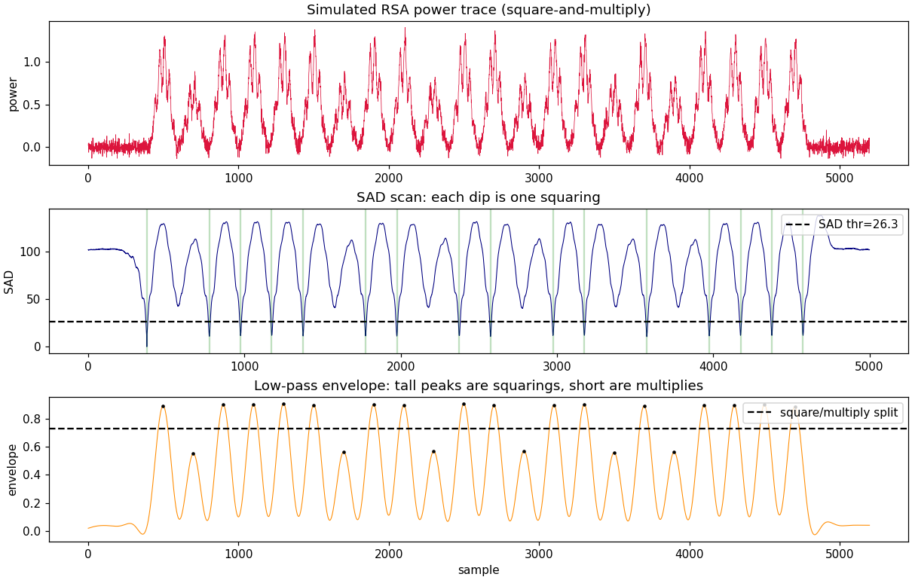

# rsa-spa-attack

A self-contained, hardware-free demonstration of a **Simple Power Analysis (SPA)
attack on RSA**. It implements the textbook square-and-multiply exponentiation,
models the power it leaks, and recovers the secret exponent from the trace by two
independent methods — then checks the recovered key is correct.

No oscilloscope, no target board and no captured data are required: every power
trace is generated from the operation sequence, so the whole attack runs offline
and reproducibly in pure Python.

> Educational. The attack targets the deliberately unprotected algorithm; this is
> exactly what constant-time / blinded exponentiation exists to prevent.

## Overview

RSA signing computes `m^d mod n`. The naive **left-to-right square-and-multiply**
algorithm does one modular **square per exponent bit** and an **extra multiply
only when the bit is 1**:

```
for bit in d (most significant first):
    acc = acc * acc  mod n        # always: a squaring
    if bit == 1:
        acc = acc * m  mod n      # only on a 1: a multiply
```

So the *sequence of operations is the exponent*. On real hardware a squaring and
a multiply draw different amounts of current and take different time, so a single
power trace reveals the whole private exponent `d`. That is the vulnerability this
project reconstructs end to end.

## Architecture

```
  secret exponent d
        │
        ▼
  rsa.modexp_square_multiply ──▶ operation sequence  S M S S S M …
        │                                   │
        │                                   ▼
        │                     leakage.simulate_trace ──▶ noisy power trace
        │                                   │
        │                 ┌─────────────────┴─────────────────┐
        │                 ▼                                   ▼
        │        sad.recover_exponent              bandwidth.recover_exponent
        │   (template-match each squaring,         (low-pass filter, find peaks,
        │    classify square vs multiply by         classify square vs multiply
        │    SAD match quality)                     by peak height)
        │                 │                                   │
        ▼                 ▼                                   ▼
     compare  ◀────── recovered d ───────────────────── recovered d
```

| Module | Responsibility |
|---|---|
| `rsaspa/rsa.py` | RSA key generation and the instrumented square-and-multiply modexp |
| `rsaspa/leakage.py` | Synthetic power-trace model (one current bump per operation + noise) |
| `rsaspa/sad.py` | SPA by Sum-of-Absolute-Differences template matching |
| `rsaspa/bandwidth.py` | SPA by low-pass filtering and peak-height classification |
| `demo/attack_demo.py` | End-to-end attack + optional figure |
| `tests/test_attack.py` | Self-tests (RSA correctness + both methods on known and random keys) |

### The two recovery methods

- **SAD template matching** (`sad.py`) — take one squaring as a reference and
  slide it across the trace. Every operation is a dip in the SAD curve; a
  squaring matches the reference almost perfectly while a multiply matches only
  partially (it draws less current). A 1-D two-means split on the dip depths
  labels each operation, and the square/multiply order is the exponent.
- **Low-pass + peak heights** (`bandwidth.py`) — an independent front-end:
  Butterworth-filter the trace to leave one clean peak per operation, then split
  the peak heights into squarings (tall) and multiplies (short) with the same
  two-means idea. Recovers the exponent including its last bit, and cross-checks
  the SAD result.

## Results

Both methods recover the exponent exactly — the 16-bit example and a real,
freshly generated 64-bit RSA private exponent:

```
$ python -m demo.attack_demo --key 0x8AB0
[SAD] recovered: 0x8AB0  -> CORRECT
[BW]  recovered: 0x8AB0  -> CORRECT

$ python -m demo.attack_demo --bits 64
Generated RSA-64 key; attacking the private exponent d
[SAD] recovered: 0x77A84206BC74FE41  -> CORRECT
[BW]  recovered: 0x77A84206BC74FE41  -> CORRECT
```

The figure below (from `--plot`) shows why it works: the power trace (top), the
SAD scan with one dip per squaring (middle), and the low-pass envelope whose tall
peaks are squarings and short peaks are multiplies (bottom).



The self-tests confirm both methods recover six random RSA exponents under noise,
and that the generated RSA keys genuinely sign and verify.

## Usage

```bash
python -m venv .venv && source .venv/bin/activate
pip install -r requirements.txt

python -m demo.attack_demo                     # generated 64-bit RSA key
python -m demo.attack_demo --key 0x8AB0 --plot # a specific exponent + figure
python -m demo.attack_demo --bits 128 --noise 0.08
python tests/test_attack.py                    # run the self-tests
```

Options: `--key HEX` (attack a chosen exponent), `--bits N` (size of a generated
key), `--noise σ` (measurement-noise level), `--seed S` (reproducible trace),
`--plot` (save a figure to `figures/`).

## Relation to real hardware

The leakage model mirrors what a side-channel capture of an 8-bit software RSA
shows: each modular operation is a burst of switching activity, and a squaring
and a multiply are distinguishable by amplitude and duration. The same analysis
code runs unchanged on a real trace array — swap `simulate_trace` for your
captured samples and the SAD and peak methods apply as-is. This repository ships
only synthetic traces so it is fully reproducible and contains no captured data.

The takeaway is the classic one: **the countermeasure is in the exponentiation,
not the cipher.** Constant-time ladders (e.g. Montgomery) and exponent/message
blinding remove the square-vs-multiply distinction this attack depends on.

## License

MIT — see [LICENSE](LICENSE).
